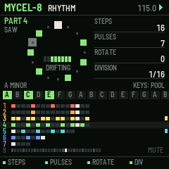
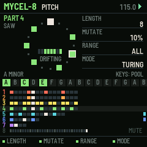
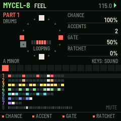
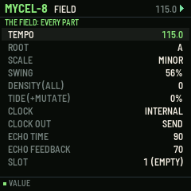

# MYCEL-8

Eight generative parts for the M-VAVE FM-1. One of six sequencer firmwares built from a survey of sequencer archetypes (see the companion survey). Built on fm1-base; makes its own sound and sends MIDI.

## What it is for

**Archetype:** Generative / algorithmic: Music Thing Turing Machine, Euclidean rhythms (Toussaint), Torso T-1.

MYCEL-8 is for growing music rather than writing it. Each of eight parts is a handful of numbers:
a Euclidean rhythm (pulses spread over steps), and a Turing-machine shift register that loops and, by a MUTATE
amount, slowly changes. The register picks its notes from a pool of scale degrees lit on the white keys, so whatever
it plays is in key. The design follows what the research found players love and hate about generative tools:
randomness always has a LOCK, dice keep a history so a good moment is never lost, density is one knob, and eight
snapshots return the whole field at the next bar.

## What it does

- 8 parts: RHYTHM (steps 1-32, pulses, rotate, division 1/32..bar), PITCH (register length, mutate %, range, mode: Turing, cycle, bounce, random, drone), FEEL (chance, accents, gate, ratchets), SOUND.
- The pool: white keys toggle scale degrees (two octaves of the key); a drum part's white keys choose its sound.
- FX: LOCK every register. PRESETS right: dice; left: back through the last 8 registers.
- DENSITY and TIDE (extra mutation) for every part at once; LFO held: denser while held. ENV: re-sync all parts.
- 8 snapshots: SAVE held + white key keeps the field, HOME held + white key brings it back at the bar.
- Key and scale: SEL held + white key sets the root, SEL + PRESETS the scale; parts keep degrees, so they follow.
- REC: the keys play the part's sound live, snapped to the key.

## The controls

Hold any button alone for a second for its help card on the screen.

| Control | What it does |
| --- | --- |
| ALGO / black keys 1-8 | the part shown |
| SELECT (or SEQ) | the page: RHYTHM, PITCH, FEEL, SOUND |
| K1-K4 | the page's four values |
| white keys | the part's pool of degrees (a drum part: its sound) |
| PRESETS | dice (right) / back through kept registers (left) |
| FX | lock |
| ARP | dice |
| LFO held | denser |
| ENV | re-sync |
| EDIT | mute the part |
| GLO held + black | mute parts; GLO tapped: the FIELD page |
| SAVE held + white 1-8 / HOME held + white 1-8 | keep / recall a snapshot |
| SEL held + white / + PRESETS | root / scale |
| REC | keys play the part |
| OCT | the part's octave |

Common to all six: PLAY starts and stops, SAVE saves to the project slot, OCT- / OCT+ the octave.

## Screens

   

## Build, test, install

The firmware is built with [fm1-base](https://github.com/charlesvestal/fm1-base) (vendored in `base/`) and JieLi's
toolchain, which runs in Docker on macOS (`colima start` first). Python 3.11 with Pillow.

    ./build.sh --host              # the host simulator, then every test in app/tests/
    ./build.sh --shots             # the screenshots in app/docs/img/
    ./build.sh                     # a development package: app/build/mycel-8.fwsc
    ./build.sh --release 0.1       # a release package: app/build/mycel-8-0.1.fwsc

Install over USB with fm1-base's installer (the FM-1 connected, Python with `python-rtmidi`):

    python3.11 base/tools/fm1_install.py app/build/mycel-8-0.1.fwsc

Keep M-VAVE's stock firmware and M-UPGRADE at hand: the installer can put the stock firmware back.

## Layout

| Path | What |
| --- | --- |
| `app/seq.c` | the sequencer: its data and the engine (runs inside the audio render, sample-exact) |
| `app/ui.c` | the controls and the screen |
| `app/app.c`, `app/app.h` | the contract with fm1-base |
| `app/core/` | shared with the five sibling firmwares: synth (8 voices, 11 drums, echo), transport and MIDI clock, project slots, controls kit, text |
| `app/tests/` | host-simulator scripts: `basic.txt` (behaviour) and `screens.txt` (pictures) |
| `app/fm1.toml` | build settings, package identity `FM-1_22`, firmware.json fields |
| `base/` | fm1-base and felucca-bsp, vendored (MPL-2.0) |

## Common to all six

- Its own sound: an 8-voice synth (saw, square, triangle, sine, noise, super-saw; resonant filter; ADSR; glide),
  eleven synthesised drums on General MIDI notes, and a shared echo. Every part also goes out as MIDI (its channel set
  on its sound page) over USB and Bluetooth MIDI.
- MIDI clock: INTERNAL (and send clock, start, stop) or FOLLOW an incoming clock. MIDI notes in play the part shown.
- Four project slots (SETUP / GLO page). SAVE while playing saves at the stop.
- Hold any button alone for a second: a help card explains it.

## Status

**0.1, untested on hardware.** It builds for the FM-1, passes its host-simulator tests, and its screens are taken
from the simulator. Nothing has been run on a real FM-1 yet; CPU load of the synth on the device is not measured.

## Licence

MPL-2.0, as fm1-base. After the Music Thing Modular Turing Machine (Tom Whitwell), Godfried Toussaint's Euclidean rhythms and the Torso T-1.
