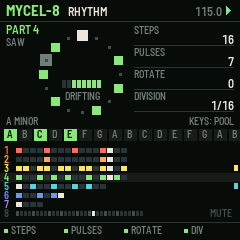
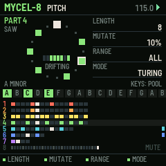
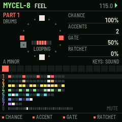
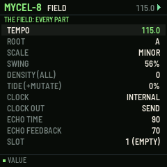

# MYCEL-8

Eight generative parts for the M-VAVE FM-1. One of six sequencer firmwares built from a survey of sequencer archetypes (see the companion survey). Built on fm1-base; makes its own sound and sends MIDI.

## What it is for

**Archetype:** Generative / algorithmic: Music Thing Turing Machine, Euclidean rhythms (Toussaint), Torso T-1.

MYCEL-8 is for growing music rather than writing it. Each of eight parts is a handful of numbers:
a Euclidean rhythm (pulses spread over steps), and a Turing-machine shift register that loops and, by a MUTATE
amount, slowly changes. The register picks its notes from a pool of scale degrees lit on the white keys, so whatever
it plays is in key. The design follows what the research found players love and hate about generative tools:
randomness always has a LOCK, dice keep a history so a good moment is never lost, density is one knob, and eight
snapshots return the whole field at the next bar.

## What it does

- 8 parts: RHYTHM (steps 1-32, pulses, rotate, division 1/32..bar), PITCH (register length, mutate %, range, mode: Turing, cycle, bounce, random, drone), FEEL (chance, accents, gate, ratchets), SOUND.
- The pool: white keys toggle scale degrees (two octaves of the key); a drum part's white keys choose its sound.
- FX: LOCK every register. PRESETS right: dice; left: back through the last 8 registers.
- DENSITY and TIDE (extra mutation) for every part at once; LFO held: denser while held. ENV: re-sync all parts.
- 8 snapshots: SAVE held + white key keeps the field, HOME held + white key brings it back at the bar.
- Key and scale: SEL held + white key sets the root, SEL + PRESETS the scale; parts keep degrees, so they follow.
- REC: the keys play the part's sound live, snapped to the key.

## The controls

Hold any button alone for a second for its help card on the screen.

| Control | What it does |
| --- | --- |
| ALGO / black keys 1-8 | the part shown |
| SELECT (or SEQ) | the page: RHYTHM, PITCH, FEEL, SOUND |
| K1-K4 | the page's four values |
| white keys | the part's pool of degrees (a drum part: its sound) |
| PRESETS | dice (right) / back through kept registers (left) |
| FX | lock |
| ARP | dice |
| LFO held | denser |
| ENV | re-sync |
| EDIT | mute the part |
| GLO held + black | mute parts; GLO tapped: the FIELD page |
| SAVE held + white 1-8 / HOME held + white 1-8 | keep / recall a snapshot |
| SEL held + white / + PRESETS | root / scale |
| REC | keys play the part |
| OCT | the part's octave |

Common to all six: PLAY starts and stops, SAVE saves to the project slot, OCT- / OCT+ the octave.

## Screens

## Install

Use the [installer page](../install/) in Chrome or Edge with the FM-1 connected by USB. Keep M-VAVE's stock firmware
and M-UPGRADE at hand: the installer can put it back. To build it yourself, see the
[source](https://github.com/davidpryan/mycel-8).

## Status

0.1, untested on hardware. It builds for the FM-1 and passes its host-simulator tests; nothing has been run on a real
FM-1 yet.
